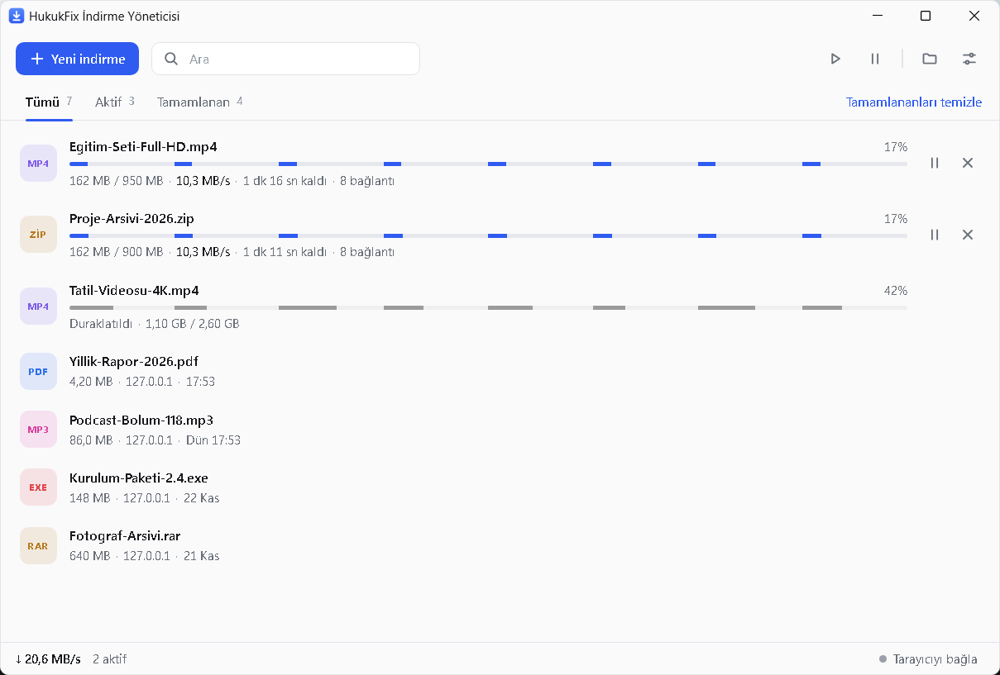

# HukukFix İndirme Yöneticisi

Windows için hızlı, sade, **ücretsiz ve açık kaynak** bir indirme yöneticisi ve ona bağlı Chrome uzantısı. Internet Download Manager gibi dosyayı çok sayıda bağlantıyla parça parça indirir; lisans ücreti, deneme süresi ve reklam yoktur.

> **Claude Fable 5.2 ile geliştirildi.** Bu programın kodu Anthropic'in Claude Fable 5.2 modeliyle yazıldı.

<p align="center"></p>

## İndir

[Releases](../../releases/latest) sayfasından **`HukukFixDM.exe`**'yi indirip çalıştırın. Program kendini kurar: `%LOCALAPPDATA%\HukukFixDM` klasörüne yerleşir, masaüstüne ve Başlat menüsüne **HukukFix İndirme Yöneticisi** kısayolunu koyar. Yönetici izni, ayrı kurulum dosyası ya da çalışma zamanı gerekmez. Sonraki sürümler kendiliğinden iner ([Otomatik güncelleme](#otomatik-güncelleme)). Program henüz kod imzalı olmadığı için ilk açılışta Windows SmartScreen "Ek bilgi → Yine de çalıştır" sorabilir.

Tek dosyadır: tarayıcı köprüsü (`HukukFixDM-host.exe`) programın içindedir ve kurulumda yanına çıkarılır. Kaldırmak için **Windows Ayarları → Uygulamalar → Yüklü uygulamalar → HukukFix İndirme Yöneticisi → Kaldır**; indirdiğiniz dosyalara dokunulmaz.

**1.1.x kullanıyorsanız** yeni `HukukFixDM.exe`'yi bir kez indirip çalıştırmanız yeterli: açık olan eski sürümü kapatıp yerine geçer, ayarlarınız ve indirme listeniz korunur. Eski zip klasörünü sonra silebilirsiniz. 1.1.x'te otomatik güncelleme olmadığı için bu adım bir kereliğine elle yapılır.

## Özellikler

- **Dinamik çok parçalı indirme** — dosya 32'ye kadar bağlantıyla indirilir. Bir bağlantı işini bitirince, kalan en büyük parçayı ikiye bölüp oradan devam eder; hiçbir bağlantı boşta beklemez.
- **Güvenilir duraklat / sürdür** — ilerleme 2 saniyede bir diske işlenir. Uygulama çökse ya da bilgisayar kapansa bile indirme açılışta kaldığı yerden kendiliğinden devam eder.
- **Bozuk dosya yok** — sürdürürken sunucudaki dosyanın değişip değişmediği `ETag` / `Last-Modified` ile doğrulanır; değiştiyse indirme baştan alınır, eski ve yeni veri asla karışmaz.
- **Sunucuya uyum** — sunucu paralel bağlantıyı sınırlıyorsa bağlantı sayısı otomatik düşer; `Range` desteklemeyen sunucularda tek akışa geçilir; kopan bağlantılar artan beklemeyle yeniden denenir.
- **Kuyruk ve hız sınırı** — aynı anda inecek dosya sayısı ve toplam hız sınırı ayarlanabilir.
- **Tarayıcı entegrasyonu** — Chrome, Edge ve Brave indirmeleri (çerezler, `Referer`, `User-Agent` ile birlikte) HukukFix'e aktarılır. HukukFix kapalıysa uzantı onu başlatır; ulaşamazsa indirme tarayıcıda devam eder, hiçbir indirme kaybolmaz.
- **Video yakalama** — sayfada oynayan videonun üzerine gelince **İndir** düğmesi çıkar; birden fazla kalite varsa (1080p, 720p…) seçtirir. Doğrudan video/ses dosyaları ve HLS (`.m3u8`) akışları desteklenir: akışın parçaları paralel indirilir, şifreliyse (AES-128) çözülür ve tek dosyada birleştirilir. Ses ile görüntüsü ayrı gelen MP4 tabanlı akışlar harici araç olmadan tek `.mp4` yapılır; MPEG-TS akışları `.ts` olarak kaydedilir. Duraklatılan akış kaldığı parçadan devam eder. Bir `.m3u8` bağlantısını doğrudan uygulamaya yapıştırmak da yeterlidir.
- **Bilerek desteklenmeyenler** — YouTube, DRM korumalı içerik (Netflix vb.) ve canlı yayınlar. Bunlar için düğme hiç gösterilmez.
- **Windows'a uygun** — sistem tepsisinde yaşar, açık/koyu tema, bildirimler, sistem proxy'si, indirilen dosyalara “internetten indirildi” işareti (SmartScreen çalışmaya devam eder).
- **Otomatik güncelleme** — yeni sürüm GitHub'dan arka planda iner, imzası doğrulanır, tek tıkla ya da bir sonraki açılışta kurulur.
- **Türkçe ve İngilizce** arayüz.

## Kullanım

1. İndirdiğiniz `HukukFixDM.exe`'yi çalıştırın. Sonraki açılışlar için masaüstündeki ya da Başlat menüsündeki **HukukFix İndirme Yöneticisi** kısayolunu kullanın.
2. Bağlantı eklemek için: **Yeni indirme**, `Ctrl+V` ile yapıştırma ya da bağlantıyı pencereye sürükleme.
3. Pencereyi kapatmak HukukFix'i kapatmaz; sistem tepsisinde çalışmaya devam eder. Çıkmak için tepsi simgesine sağ tıklayıp **Çıkış**.

### Chrome uzantısını yükleme

Uzantı henüz Chrome Web Mağazası'nda olmadığı için bir kereliğine elle yüklenir:

1. HukukFix'te **Ayarlar → Tarayıcı** bölümünü açın ve **Chrome** düğmesine basın (`chrome://extensions` açılır).
2. Sağ üstten **Geliştirici modu**nu açın.
3. **Paketlenmemiş öğe yükle**'ye tıklayıp Ayarlar'da gösterilen klasörü seçin
   (`%LOCALAPPDATA%\HukukFixDM\extension` — **Kopyala** düğmesiyle yolu alabilirsiniz).

Bağlantı kurulunca HukukFix'in sağ alt köşesinde **Tarayıcı bağlı** yazar. Edge ve Brave için adımlar aynıdır.

### Otomatik güncelleme

HukukFix açıldıktan 10 saniye sonra ve açık kaldıkça 6 saatte bir GitHub'daki son sürüme bakar; internete ulaşamazsa 10 dakika sonra yeniden dener. Yeni sürüm varsa arka planda indirir; pencerenin üstünde **Yeni sürüm hazır** şeridi ve bir Windows bildirimi çıkar. **Yeniden başlat**'a basınca ya da programı bir sonraki açışınızda yeni sürüm kurulur; ayarlar ve indirme listesi korunur. **Ayarlar → Genel → Otomatik güncelle** ile kapatılabilir; Ayarlar'ın en altındaki **Güncellemeleri denetle** her zaman çalışır.

Her sürümün yanında bir imza dosyası (`HukukFixDM.exe.sig`) bulunur: sürüm numarasını, dosya boyutunu ve SHA-256 özetini bir Ed25519 anahtarıyla imzalar. Anahtarın açık yarısı programın içindedir; gizli yarısı ne bu depoda ne GitHub'dadır. Program indirdiği dosyayı imza, sürüm numarası ve özet birebir tutmadıkça kurmaz. Bu yüzden GitHub hesabı ele geçirilse, dosya yolda değiştirilse ya da eski bir sürüm yeni diye sunulsa bile kullanıcıya kod gönderilemez. İndirme yalnızca HTTPS üzerinden yapılır.

## Kaynaktan derleme

Yalnızca [Go](https://go.dev/dl) gerekir (Node ya da C derleyicisi gerekmez).

```powershell
powershell -ExecutionPolicy Bypass -File build.ps1 -Test
```

Çıktı `build\bin\HukukFixDM.exe`'dir; tarayıcı köprüsü önce derlenip içine gömülür.

**Sürüm yayımlama:** `internal/shared/shared.go` içindeki `Version` ile `wails.json` içindeki `productVersion` aynı sürüme çekilir, sonra `-Sign <gizli anahtar dosyası>` ile derlenir. `build\release\` altına `HukukFixDM.exe` ve `HukukFixDM.exe.sig` yazılır ve imza programdaki açık anahtarla denetlenir. Bu iki dosya `v<sürüm>` etiketli (ör. `v1.2.0`) GitHub sürümüne eklenir. Gizli anahtar `go run ./tools/updsign keygen <dosya>` ile bir kez üretilmiştir ve depoya girmez; kaybolursa yeni anahtarla imzalanan sürümleri kurulu programlar kabul etmez.

| Klasör | İçerik |
|---|---|
| `internal/engine` | İndirme motoru ve testleri (`go test ./internal/...`) |
| `cmd/hukukfix-host` | Tarayıcının çalıştırdığı native messaging host (programın içine gömülür) |
| `internal/update` | Güncellemenin imza, sürüm ve özet denetimi ve testleri |
| `frontend/dist` | Arayüz (derleme adımı olmayan düz HTML/CSS/JS) |
| `extension` | Tarayıcı uzantısı (Manifest V3) |
| `main.go`, `app.go`, `bridge.go`, `tray.go` | Pencere, yerel köprü API'si, tepsi simgesi |
| `install_windows.go`, `shortcut_windows.go`, `updater.go` | Kendini kurma, kısayollar, kaldırma, otomatik güncelleme |
| `tools` | İkon üretici, uzantı anahtarı üretici, sürüm imzalayıcı (`tools/updsign`), arayüz önizleme sunucusu, indirme ve uzantı deneme araçları, uçtan uca test (`tools/e2e`) |

### Testler

```powershell
go test ./internal/...                                              # indirme motoru ve güncelleme denetimi
powershell -ExecutionPolicy Bypass -File tools\e2e\calistir.ps1     # uçtan uca, gerçek pencere
```

Uçtan uca test, programın test sürümünü (`-tags e2e`, yalnız testte derlenen `e2e_hook.go`) geçici bir veri klasörüne kurar ve arayüzdeki düğmelere gerçekten basar:

- **Kurulum:** tek exe'nin kendini kurup kurulu kopyaya devretmesi, gömülü köprünün çıkarılması, masaüstü ve Başlat menüsü kısayolları, "Yüklü uygulamalar" kaydı, aynı sürüm yeniden çalıştırılınca yeniden kopyalanmaması.
- **İndirme:** ekleme, duraklat/sürdür, tümünü duraklat/sürdür, iptal, listeden kaldır, dosyayı sil, başarısız indirme ve yeniden deneme, sekmeler ve arama, tamamlananları temizle (liste tamamen boşalınca dahil), kapatıp açınca kaldığı yerden sürdürme.
- **Tarayıcı:** köprü (uzantı → `HukukFixDM-host.exe` → program) ve kapalı programın uzantı tarafından başlatılması.
- **Arayüz:** sürükle-bırak, klavye kısayolları, tema ve dil, ayarlar penceresinin farklı pencere boyutlarında sığıp kayması.
- **Otomatik güncelleme:** başka anahtarla imzalanmış, sürüm numarası değiştirilmiş, eski imzası yeniden kullanılmış ve imzadan sonra değiştirilmiş paketlerin reddedilmesi; doğru sürümün indirilip **Yeniden başlat**la ve bir sonraki açılışta kurulması.
- **Kaldırma:** kaldırma ve yeniden kurulum.

İndirmeler ve "GitHub" yalnız testin 127.0.0.1'de açtığı sunucudur; her dosya bayt bayt doğrulanır. Güncelleme testi her çalıştırmada üretilen geçici bir imza anahtarı ve 9.9.9 numaralı bir test derlemesi kullanır. Kısayollar masaüstüne değil geçici klasöre konur. Program kayıt defterine tarayıcı köprüsünü, otomatik başlatmayı ve "Yüklü uygulamalar" kaydını yazdığı için betik bu anahtarları önce yedekler, sonra geri yükler. Test sürümü yalnızca bu betikle açılır; betik ayrıca gerçek veri klasörünün (`%LOCALAPPDATA%\HukukFixDM`) derlemeden ve testten önceki hâliyle aynı kaldığını denetler.

## Sürüm notları

- **1.2.2** — Güncelleme denetimi açılıştan 45 saniye yerine 10 saniye sonra yapılıyor. İnternete ulaşılamadığı ya da indirme yarıda kaldığı için başarısız olan denetim 6 saat yerine 10 dakika sonra yineleniyor. Uçtan uca test 138 adım.
- **1.2.1** — Pencere başlığında sürüm numarası ("HukukFix İndirme Yöneticisi 1.2.1"). Tarayıcı eklentisi henüz hiç bağlanmamışsa sağ altta eklentinin nasıl ekleneceğini gösteren küçük bir uyarı çıkar; eklenti bir kez bağlanınca bir daha gösterilmez. "Güncellemeleri denetle" sonucunu açıkça gösteriyor: denetlerken dönen bir gösterge, güncelse yeşil onay işareti ve "En güncel sürümü kullanıyorsunuz" bildirimi, denetlenemezse nedeni. Ayarlar'ın altındaki sürüm satırı ayraçlarla düzenlendi. Uçtan uca test açık bir HukukFix varken de çalışıyor; 137 adım.
- **1.2.0** — Tek dosya, kendini kuran program ve otomatik güncelleme. `HukukFixDM.exe` çalıştırılınca `%LOCALAPPDATA%\HukukFixDM` içine kurulur, masaüstüne ve Başlat menüsüne kısayol koyar, "Yüklü uygulamalar"dan kaldırılabilir. Tarayıcı köprüsü programın içine gömüldü; ayrı `HukukFixDM-host.exe` dosyası yok. Yeni sürümler GitHub'dan kendiliğinden iner; Ed25519 imzası, sürüm numarası ve SHA-256 özeti doğrulanınca kurulur. Uçtan uca test 124 adım.
- **1.1.2** — Ayarlar penceresi aşağı kaymıyordu: pencere ekrandan uzun oluyor, alttaki ayarlar (tarayıcı bölümü, uzantı kurulumu) ekranın dışında kalıyordu. Pencere artık ekrana sığıyor, içerik kendi içinde kayıyor; en küçük pencere boyutunda da. Uçtan uca teste kaydırma ve pencere sığma adımları eklendi (73 adım).
- **1.1.1** — Hepsi tamamlanmışken "Tamamlananları temizle"ye basınca ya da listedeki son indirme kaldırılınca pencere eski satırları göstermeye devam ediyordu (boş liste pencereye hiç gönderilmiyordu). Düzeltildi. Açık temada pencere açılırken koyu renkte yanıp sönmüyor. Uçtan uca test eklendi (68 adım).
- **1.1.0** — İlk açık kaynak sürüm.

## Güvenlik tasarımı

- Uygulama yalnızca `127.0.0.1` üzerinde dinler. Her istek, rastgele üretilmiş 256 bitlik bir **erişim anahtarı** taşımak zorundadır.
- Tarayıcı uygulamaya hiç doğrudan bağlanmaz. Uzantı her isteğini native messaging host'a (`HukukFixDM-host.exe`) verir; host isteği uygulamaya iletir. Tarayıcı o host'a yalnızca HukukFix uzantısının kimliğiyle erişim verir.
- Erişim anahtarı tarayıcıya hiç ulaşmaz; yalnızca uygulama ile host arasında kalır. Sıradan web sayfaları anahtarı ne okuyabilir ne tahmin edebilir; `Host` denetimi DNS rebinding saldırılarını engeller.
- Bu tasarım, tarayıcıların yerel ağ (127.0.0.1) isteklerine getirdiği kısıtlamalardan da etkilenmez.
- Çerezler yalnızca indirmenin istendiği sunucuya gönderilir, yönlendirilen başka sunuculara gönderilmez ve indirme bitince silinir.
- Sunucunun gönderdiği dosya adları temizlenir; bir sunucu indirme klasörünün dışına dosya yazdıramaz.
- Güncellemeler yalnızca imzalıysa kurulur ([Otomatik güncelleme](#otomatik-güncelleme)). Yeni sürümün eskisini kapatma isteği köprüde ayrı bir başlık ister; uzantı ve web sayfaları bu isteği gönderemez.

### Sorun giderme

Uzantı penceresinde **Çalışmıyor** yazıyorsa altındaki küçük gri satır nedeni söyler. `%LOCALAPPDATA%\HukukFixDM\host.log` dosyası tarayıcıdan gelen her çağrıyı ve sonucunu (adresler ve çerezler hariç) kaydeder; dosya hiç oluşmuyorsa tarayıcı host'u başlatamıyor demektir. `tools\exttest.ps1`, uzantıyı geçici bir tarayıcı profilinde çalıştırıp denemek içindir (Chrome 137 ve sonrası komut satırından uzantı yüklemeyi engellediği için yalnızca buna izin veren Chromium tabanlı tarayıcılarda çalışır).

`tools\dltest` tek bir bağlantıyı (dosya ya da `.m3u8` akışı) uygulama olmadan motorla indirip sonucu yazar:
`go run ./tools/dltest <klasör> <bağlantı> [kalite]`.

## Yol haritası

- Kod imzalama (imzasız `.exe` ilk açılışta SmartScreen uyarısı gösterir)
- Uzantının Chrome Web Mağazası'nda yayınlanması
- DASH (`.mpd`) akışları; sesi ayrı gelen MPEG-TS akışları; `.ts` çıktısının MP4'e çevrilmesi

## Lisans

MIT — bkz. [LICENSE](LICENSE).

*Internet Download Manager, Tonec Inc.'in ticari markasıdır; bu proje onunla bağlantılı değildir ve onun kodunu içermez.*
